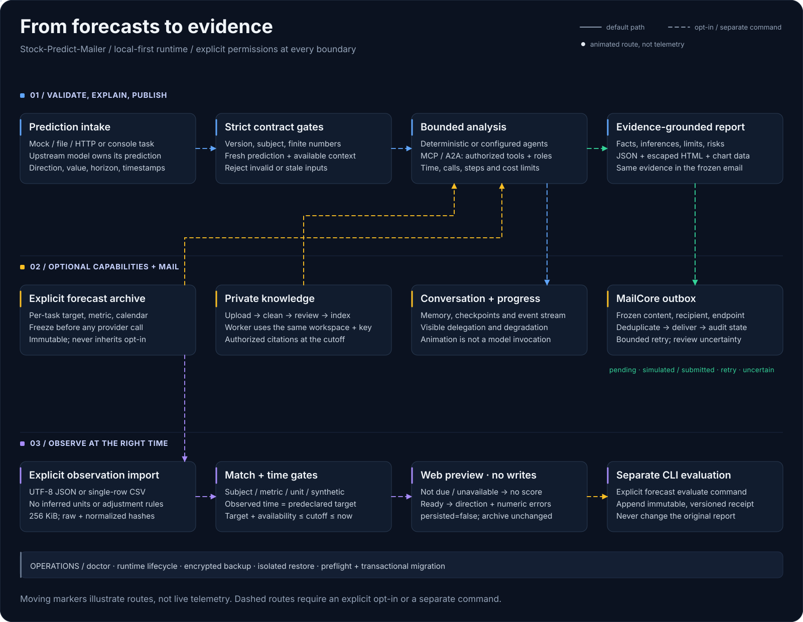

# Stock-Predict-Mailer

**Turn upstream forecasts into evidence-grounded reports, traceable evaluations, and reliable email notifications.**

English · [简体中文](README.zh-CN.md)

[](https://github.com/Yyk-Lqh/Stock-Predict-Mailer/actions/workflows/ci.yml)
[](https://github.com/Yyk-Lqh/Stock-Predict-Mailer/tags)
[](pyproject.toml)
[](.github/workflows/ci.yml)
[](.github/workflows/ci.yml)
[](LICENSE)
[](CONTRIBUTING.md)
[](https://github.com/Yyk-Lqh/Stock-Predict-Mailer/commits/main/)

A local-first Python application for consuming model predictions, checking their contracts, and explaining them with clearly separated facts, inferences, limitations, and risks. Start with synthetic inputs and local `.eml` delivery; connect your own prediction provider, models, tools, and SMTP only when you choose.

[Quick start](#quick-start) · [Runtime flow](#runtime-flow) · [Capabilities](#capabilities) · [Status](#project-status) · [Documentation](#documentation) · [Contributing](CONTRIBUTING.md) · [Security](SECURITY.md)

## Why this project

- **Grounded analysis.** Strict v1 inputs, explicit freshness checks, source-linked evidence, and visible degradation when optional agents fail.
- **Reliable delivery.** A persistent outbox, idempotency, frozen message content and endpoints, bounded retries, and manual resolution of uncertain outcomes.
- **Point-in-time evaluation.** Predeclare the target, metric, unit, reference, and calendar; match observations before scoring. Preview never writes a receipt.
- **Private research workspace.** Versioned documents, independent cleaning and review, optional embeddings, and task-scoped access to evidence and archives.
- **Operational control.** Read-only diagnostics, managed component lifecycle, encrypted backups, isolated restores, and fenced single-database migrations.

This is a **single-user, loopback-only tool**, not an internet-facing multi-tenant service. The default analysis does not train a model or execute trades. Forecasts and confidence values are upstream claims, not a guarantee of investment returns.

## Quick start

### 1. Install

Use Python **3.11+**, Git, and [uv](https://docs.astral.sh/uv/getting-started/installation/).

```shell
git clone https://github.com/Yyk-Lqh/Stock-Predict-Mailer.git
cd Stock-Predict-Mailer
uv sync --locked
```

### 2. Generate a report and simulated email

```shell
uv run stock-predict-mailer --config config/agent-example.toml run --send
```

The bundled configuration uses Mock predictions, deterministic analysis, and file transport. No API key, model download, or mailbox is required. The JSON output includes the report path, analysis status, and mail ID. `simulated` means an `.eml` file was written under `data/agent-local/sent/`; it does not mean an email was sent.

Use `run` without `--send` to generate the report and enqueue delivery. Mock input changes over time; idempotency applies when the analysis and delivery identity are unchanged.

### 3. Open the local console

```shell
uv run stock-predict-mailer --config config/agent-example.toml console --port 8767
```

Open [127.0.0.1:8767](http://127.0.0.1:8767). The console includes conversations, structured prediction input, execution progress, reports, knowledge tools, and forecast archives. Model-driven console tasks need a configured model; without one, tasks may fall back to a clearly marked deterministic report. The CLI demo remains independent.

Without `STOCK_PREDICT_MAILER_MASTER_KEY`, the console uses a separate development database and key. Preserve existing keys and workspace paths when changing configuration. See the [console guide](docs/control-console.md).

## Runtime flow

[](docs/assets/runtime-flow.en.svg)

**Open the diagram for a larger view.** Moving markers illustrate control flow; they are not live task telemetry. The diagram supports reduced-motion preferences. Static readers retain every label and connection; a detailed [Mermaid reference and stage-by-stage explanation](docs/runtime-flow.md) is also available.

1. **Receive and validate.** File/HTTP/Mock predictions and optional context pass schema, finite-number, subject, and freshness checks. Invalid inputs stop the task.
2. **Freeze an optional forecast.** A definition supplied explicitly for this task fixes its target and scoring rules before context tools, knowledge retrieval, and analysis providers run. It is not inherited by the next conversation turn.
3. **Analyze within bounds.** Deterministic analysis or configured agents use approved evidence. Console orchestration controls tools, delegation, time, steps, and budget; failures remain visible.
4. **Publish and deliver.** JSON/HTML reports and frozen email share evidence. Delivery follows the outbox state machine; ambiguous SMTP outcomes require explicit review.
5. **Evaluate later.** Task-authorized JSON/single-row CSV observations must match the archived definition and cutoff. The web preview does not change archive state. Explicit CLI evaluation appends immutable receipts.

## Capabilities

### Analysis workspace

Import upstream predictions, inspect numerical or directional forecasts, follow execution events, and review reports and evidence in one conversation. Optional MCP tools and A2A delegation remain permission- and budget-bound. The securities hall distinguishes demonstration displays from configured market sources.

The desktop console starts in a focused workspace with direct model, input, and result actions; the securities hall remains available. Reports offer source-based reading highlights, evidence navigation, focused reading, and a return to the same history position. Session switching protects drafts and explains loading or retry states; keyboard menus close one layer at a time.

Hidden scenes stop continuous drawing, task refreshes share in-flight reads, and loaded lists reuse unchanged rows. Search labels distinguish loaded records from global search. These changes preserve the existing API and four console asset paths.

[Workbench](docs/console-workbench.md) · [Desktop change plan](docs/desktop-frontend-optimization-plan.md) · [Protocols and API](docs/control-api.md) · [Execution and charts](docs/hybrid-execution.md) · [Securities hall](docs/securities-hall.md)

### Forecast archives and observations

Use `run --evaluation-definition definition.json` or provide `evaluation_definition` to a task. Query `forecast list/show`, or inspect authorized task archives in the console. The web observation importer accepts UTF-8 JSON or an explicit single-row CSV, preserves source-content hashes, and gates scoring on maturity and availability.

**Prediction intake expiry and forecast maturity are different.** A mature archived forecast can be evaluated after its original intake expiry. Browser previews return `persisted=false`; official receipts require explicit CLI evaluation.

[Archive and scoring](docs/forecast-evaluation.md) · [Task binding](docs/forecast-tasks.md) · [Console archives](docs/forecast-console.md) · [Observation preview](docs/observation-preview.md)

### Private knowledge

Import PDF, DOCX, UTF-8 text/Markdown/CSV/JSON, and XLSX with the relevant optional dependencies. Cleaning, review, indexing, and publication are separate stages. Optional embeddings and semantic cleaning use separately configured providers; retrieved material reaches an analysis model only through the authorized task flow. Snippets and search indexes are not encrypted at rest.

```shell
uv sync --locked --extra knowledge
uv run stock-predict-mailer --config config/agent-example.toml knowledge-worker --once
```

Uploading queues work; it does not finish ingestion. Run the worker against the **same configuration, workspace, and key** as the console. Advanced semantic cleaning is opt-in.

Desktop knowledge tools expose queue states, actual versions, and candidate/source comparison. Model settings separate saving, connection tests, and default selection; MCP discovery requires explicit permission saving. The intake center shows per-file upload outcomes, explicit failed-item retries, mapping validation, and processing-specific publication receipts.

[Private knowledge](docs/private-knowledge.md) · [Cleaning and review](docs/cleaning-agent.md) · [Conversation memory](docs/conversation-memory.md)

### Email and operations

`mail-list`, `send`, `mail-drain`, and `mail-resolve` expose persistent delivery state. File transport is local simulation. SMTP `submitted` means server acceptance, not inbox delivery; `uncertain` must not be silently resent. Diagnostics and backup plans are read-only; migration and restore operations use explicit gates.

```shell
uv run stock-predict-mailer --config config/agent-example.toml doctor
uv run stock-predict-mailer --config config/agent-example.toml runtime status console
```

[Mail configuration](docs/mail-and-running.md) · [MailCore](docs/mail-core-migration.md) · [Diagnostics](docs/runtime-diagnostics.md) · [Lifecycle](docs/runtime-lifecycle.md) · [Backup/restore](docs/workspace-backup.md) · [Database migration](docs/database-migration.md)

### Optional crawler and legacy research

The default application consumes forecasts. An optional, separately operated crawler and retained research tools are available for explicit workflows; the default CLI does not automatically collect market-wide data or train models.

```shell
uv sync --locked --extra crawler
uv run stock-predict-mailer-crawler-verify
```

[Crawler service](docs/crawler-service.md) · [Crawler jobs](docs/crawler-jobs.md) · [Single-symbol workflow](docs/single-symbol-analysis.md) · [Legacy tools](docs/legacy-readme.md)

## Project status

Version **0.6.0**. This is a working local tool, not a hosted service. The table separates what is exercised today from what remains unverified.

| Area | Status | Notes |
| --- | --- | --- |
| CLI, console, reports | Available | Mock input, deterministic analysis, local `.eml` delivery |
| Desktop workbench | Locally verified | Focus/hall views, report evidence navigation, draft protection, and persistent retry feedback |
| Real model and project MCP | Bounded integration verified | DeepSeek Flash structured output and project MCP discovery/read-only status passed with synthetic inputs; other profiles and modes need their own validation |
| Forecast archive and scoring | Available | Official receipts only through the explicit CLI command |
| Private knowledge and memory | Available with optional extras | Embeddings and semantic cleaning are configured separately |
| Mail delivery | Simulated by default | One QQ SMTP test was accepted and receipt confirmed by the user; deliverability, bounces, quotas, and bulk sending were not evaluated |
| Market data | Collectable, long-term reliability unverified | Hall quotes are display-only; `bars-fetch` pulls unadjusted daily bars from Eastmoney into a contract CSV that only reaches training after a snapshot; no licence or SLA |
| Plugin system | Quote sources and report renderers available | Static whitelist: Tencent/Sina form the default quote chain, Eastmoney is opt-in; `sources` reloads without a restart and a bad edit keeps the previous chain; reports record their renderers in `renderers.json`; `plugins-check` validates before startup; notification channels are contract-only |
| Hosted multi-user use | Out of scope | No authentication layer beyond the local principal |
| Branch protection | Not enforced yet | Review and merge rules are conventions until repository rulesets are enabled |

The [live integration record](docs/real-integration-validation.md) separates provider responses, application budgets, SMTP submission, and user-confirmed receipt. Live credentials and workspace configuration are not bundled. Continuing SMTP operation requires local credential injection, explicit transport selection, and a service reload after backend changes.

## Development

```shell
uv sync --all-extras --locked
uv run ruff check src/stock_predict_mailer src/mcp_server tests scripts
uv run python -m unittest discover -s tests -v
uv run python scripts/build_console.py --check --check-budget
```

Tests use `unittest`. CI covers Linux and Windows, Python 3.11/3.13 full environments, and environments without research dependencies. Optional-dependency installation is required for the full suite. Keep generated `control/web/memory.js` synchronized using `scripts/build_console.py`.

For one local entry point, run `uv run --locked --all-extras python scripts/check_desktop_delivery.py --full`. Omit `--full` for static checks. Each run stops on the first failure and keeps step logs and a JSON summary under the ignored `.tmp/desktop-delivery/` directory. See [desktop delivery validation](docs/desktop-delivery-validation.md) for isolated gstack browser fixtures, OS-privilege skips, and actual results.

The distribution/CLI is `stock-predict-mailer`, the import package is `stock_predict_mailer`, and environment variables use `STOCK_PREDICT_MAILER_`. Follow the [contribution guide](CONTRIBUTING.md) for checks, naming, synthetic fixtures, and PR requirements.

## Documentation

- **Start here:** [documentation index](docs/README.md), [input contracts](docs/interfaces.md), [frontend handoff](docs/frontend-handoff.md).
- **Understand the flow:** [runtime architecture](docs/runtime-flow.md), [current roadmap](docs/optimization-roadmap.md).
- **Operate safely:** [security policy](SECURITY.md), [migration preflight](docs/migration-preflight.md), [schema rehearsal](docs/schema-planning.md).
- **Explore history:** [legacy README](docs/legacy-readme.md), [remote integration record](docs/remote-update-2026-11-15.md).

Some detailed operational manuals are currently Chinese. Both landing pages link to the same source documents so their behavior stays aligned.

## Community and support

Read [Contributing](CONTRIBUTING.md) and the [Code of Conduct](CODE_OF_CONDUCT.md) before participating. Use [Issues](https://github.com/Yyk-Lqh/Stock-Predict-Mailer/issues) for reproducible bugs or scoped proposals. Follow [Security](SECURITY.md) for sensitive reports; never publish credentials or private datasets in an issue.

## License

[MIT](LICENSE) · Copyright © 2026 Yyk-Lqh. Preserve third-party notices and any separate data/model terms. The canonical English license remains unchanged; a [Chinese reference translation](LICENSE.zh-CN.md) is available.
