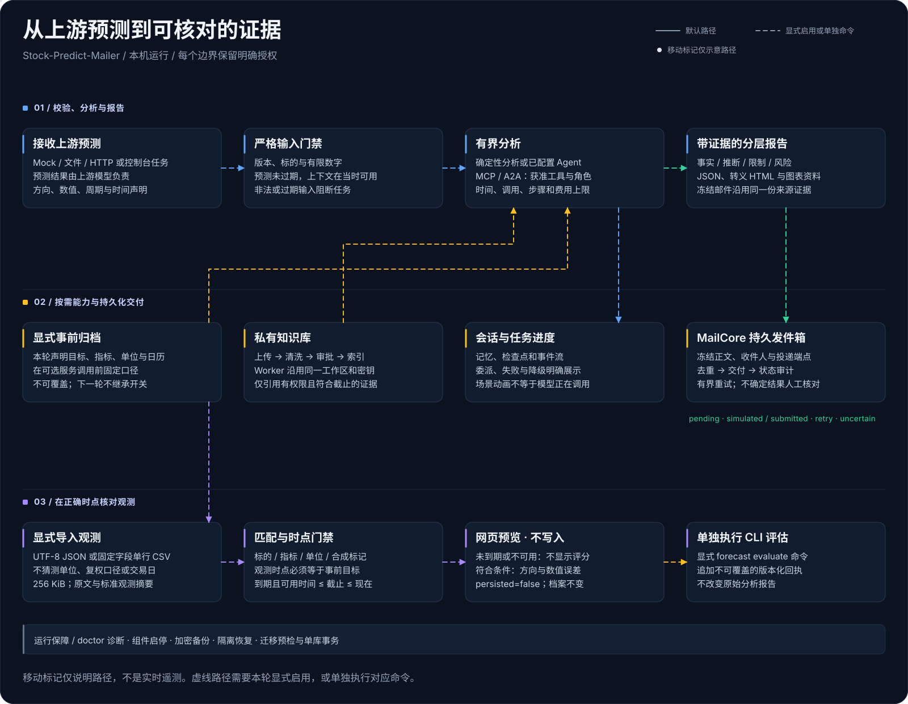

# Stock-Predict-Mailer

**将上游预测转化为有据可查的分析报告、时点评估与可靠邮件通知。**

[English](README.md) · 简体中文

[](https://github.com/Yyk-Lqh/Stock-Predict-Mailer/actions/workflows/ci.yml)
[](https://github.com/Yyk-Lqh/Stock-Predict-Mailer/tags)
[](pyproject.toml)
[](.github/workflows/ci.yml)
[](.github/workflows/ci.yml)
[](LICENSE)
[](CONTRIBUTING.md)
[](https://github.com/Yyk-Lqh/Stock-Predict-Mailer/commits/main/)

面向本机的 Python 应用：接收模型预测，严格校验输入，并将事实、推断、限制和风险分开说明。默认使用合成预测、确定性分析和本地 `.eml` 邮件文件；上游预测服务、模型、工具及 SMTP 均由你显式配置。

[快速开始](#快速开始) · [动态运行流程](#动态运行流程) · [核心能力](#核心能力) · [项目状态](#项目状态) · [文档导航](#文档导航) · [贡献指南](CONTRIBUTING.md#chinese) · [安全策略](SECURITY.md#chinese)

## 为什么使用这个项目

- **分析有依据：** 严格 v1 契约、时效门禁、来源证据与明确的降级状态。
- **通知可追踪：** 持久化发件箱、幂等、冻结正文与端点、有界重试和不确定状态人工确认。
- **评价遵守时点：** 事前声明目标、指标、单位、基准和日历，匹配观测后评分；预览不写回执。
- **私有研究空间：** 资料版本、独立清洗与复核、可选 Embedding，以及按任务权限查询证据和档案。
- **运行可管理：** 只读诊断、组件启停、加密备份、隔离恢复与有保护的单库迁移。

这是**单用户、仅监听本机回环地址的工具**，不作为公网多租户服务。默认分析不训练模型，也不执行交易。预测和置信度是上游声明，不代表投资收益保证。

## 快速开始

### 1. 安装

准备 Python **3.11+**、Git 和 [uv](https://docs.astral.sh/uv/getting-started/installation/)。

```shell
git clone https://github.com/Yyk-Lqh/Stock-Predict-Mailer.git
cd Stock-Predict-Mailer
uv sync --locked
```

### 2. 生成报告与模拟邮件

```shell
uv run stock-predict-mailer --config config/agent-example.toml run --send
```

示例配置使用 Mock、确定性分析和文件投递，不需要 API 密钥、下载模型或邮箱。JSON 输出包括报告路径、分析状态和邮件 ID。`simulated` 表示 `.eml` 写入 `data/agent-local/sent/`，没有向外发送邮件。

去掉 `--send` 时仅生成报告并入队。Mock 输入会随时间变化；只有分析和投递身份相同的请求才适用重复去重。

### 3. 打开本机控制台

```shell
uv run stock-predict-mailer --config config/agent-example.toml console --port 8767
```

访问 [127.0.0.1:8767](http://127.0.0.1:8767)，使用会话、结构化预测、执行进度、报告、知识库与预测归档。控制台的模型分析任务需要配置模型；未配置时可能退回明确标注的确定性报告，CLI 演示仍独立可用。

未设置 `STOCK_PREDICT_MAILER_MASTER_KEY` 时使用独立开发库与开发密钥。调整配置时保留已有密钥和工作区路径，详见[控制台手册](docs/control-console.md)。

## 动态运行流程

[](docs/assets/runtime-flow.zh-CN.svg)

**点击流程图查看大图。** 移动标记仅说明执行路径，不是实时任务遥测；支持系统减少动态效果偏好。静态阅读器仍能显示完整节点与连接，另附[详细 Mermaid 流程与逐阶段解释](docs/runtime-flow.md#chinese)。

1. **接收与校验：** File/HTTP/Mock 预测和可选上下文经过字段、有限数字、标的与时效检查；非法输入阻断任务。
2. **可选事前归档：** 本轮显式提供定义，在上下文工具、知识检索和分析服务调用前固定目标及评分口径；下一轮不自动继承。
3. **有界分析：** 确定性分析或已配置 Agent 使用获准证据；编排限制工具、委派、时间、步骤和预算，失败与降级保留可见记录。
4. **报告与交付：** JSON/HTML 和冻结邮件共享证据；按发件箱状态机交付，SMTP 结果不确定时需人工确认。
5. **到期评价：** 有权访问任务的 JSON/单行 CSV 观测须匹配定义和截止时间；网页预览不改档案，显式 CLI 评估追加不可覆盖回执。

## 核心能力

### 分析工作台

导入上游数值或方向预测，在同一会话中跟进执行事件、报告和来源证据。可选 MCP 工具及 A2A 委派受授权与预算控制；证券大厅明确区分演示内容和已配置的行情来源。

桌面控制台默认进入专注工作区，直接提供模型、资料和结果入口，也可切换证券大厅。报告支持原文重点、证据往返、专注阅读及返回原历史位置。切换会话保护草稿，明确显示加载和重试状态；键盘菜单逐层关闭。

隐藏场景暂停持续绘制，任务刷新合并在途读取，已加载列表复用未变化的行。搜索提示区分已加载记录与全局搜索，保留现有 API 和控制台四个静态资源路径。

[会话式工作台](docs/console-workbench.md) · [桌面优化计划](docs/desktop-frontend-optimization-plan.md) · [协议与 API](docs/control-api.md) · [执行与图表](docs/hybrid-execution.md) · [证券大厅](docs/securities-hall.md)

### 预测归档与观测

使用 `run --evaluation-definition definition.json`，或向任务提供 `evaluation_definition`。通过 `forecast list/show` 查询，或在控制台查看有权访问任务的预测。网页接受 UTF-8 JSON 或明确字段的单行 CSV，保留来源内容摘要，并按到期/可用时点控制评分。

**预测接收有效期和目标到期时间不同。** 归档预测即使已过原接收有效期，也可按事前定义评价到期结果。网页预览返回 `persisted=false`；正式回执仍需显式 CLI 评估。

[归档与评分](docs/forecast-evaluation.md) · [任务绑定](docs/forecast-tasks.md) · [控制台档案](docs/forecast-console.md) · [观测预览](docs/observation-preview.md)

### 私有知识库

按需安装依赖后导入 PDF、DOCX、UTF-8 文本/Markdown/CSV/JSON 和 XLSX。清洗、复核、索引及发布分开运行。Embedding 和语义清洗分别配置服务；资料仅通过获准的任务流程进入分析模型。片段和全文检索索引并非静态加密存储。

```shell
uv sync --locked --extra knowledge
uv run stock-predict-mailer --config config/agent-example.toml knowledge-worker --once
```

上传表示排队，不等于完成入库。Worker 必须与控制台沿用**同一配置、工作区和密钥**，高级语义清洗需显式开启。

桌面知识工具展示队列状态、实际版本及候选/来源对照。模型设置区分保存、连接测试和默认选择，MCP 发现结果需显式保存权限。数据接入中心提供逐文件上传结果、失败项显式重传、映射校验及按处理批次记录的发布回执。

[私有知识库](docs/private-knowledge.md) · [清洗与审批](docs/cleaning-agent.md) · [会话记忆](docs/conversation-memory.md)

### 邮件与运行管理

`mail-list`、`send`、`mail-drain` 和 `mail-resolve` 管理持久化投递。文件投递是本地模拟；SMTP 的 `submitted` 仅代表服务器接收，`uncertain` 不可静默重发。诊断与备份计划只读，迁移和恢复使用显式门禁。

```shell
uv run stock-predict-mailer --config config/agent-example.toml doctor
uv run stock-predict-mailer --config config/agent-example.toml runtime status console
```

[邮件配置](docs/mail-and-running.md) · [MailCore](docs/mail-core-migration.md) · [诊断](docs/runtime-diagnostics.md) · [启停](docs/runtime-lifecycle.md) · [备份恢复](docs/workspace-backup.md) · [数据库迁移](docs/database-migration.md)

### 可选采集与历史研究工具

默认应用消费预测。独立采集器及保留的研究工具用于显式工作流；默认 CLI 不会自动采集全市场数据或训练模型。

```shell
uv sync --locked --extra crawler
uv run stock-predict-mailer-crawler-verify
```

[采集服务](docs/crawler-service.md) · [持久化采集任务](docs/crawler-jobs.md) · [单标的流程](docs/single-symbol-analysis.md) · [历史工具](docs/legacy-readme.md)

## 项目状态

版本 **0.5.0**。这是可用的本机工具，不是托管服务。下表区分当前确实演练过的能力与仍未验证的部分。

| 范围 | 状态 | 说明 |
| --- | --- | --- |
| CLI、控制台与报告 | 可用 | Mock 输入、确定性分析、本地 `.eml` 投递 |
| 桌面工作台 | 已完成本地验证 | 专注/大厅视图、报告证据导航、草稿保护和持续重试反馈 |
| 真实模型与项目 MCP | 已完成有界联调 | 合成输入下通过 DeepSeek Flash 结构化输出及项目 MCP 发现/只读状态；其他配置与强度需分别验证 |
| 预测归档与评分 | 可用 | 正式回执只能通过显式 CLI 命令写入 |
| 私有知识库与会话记忆 | 安装可选依赖后可用 | Embedding 与语义清洗分别配置 |
| 邮件投递 | 默认文件模拟 | QQ SMTP 接受单封测试，用户已确认收到；送达率、退信、配额与批量发送未评估 |
| 行情数据 | 仅用于显示 | 证券大厅中继公开报价，不作为任务采集端 |
| 托管多用户 | 非目标 | 除本机 principal 外没有认证层 |
| 分支保护 | 尚未启用 | 在启用仓库规则集前，审查与合并属于约定 |

[真实联调记录](docs/real-integration-validation.md)区分供应商响应、应用预算、SMTP 提交和用户确认收件。发布内容不包含真实凭据和工作区配置；持续 SMTP 运行仍需在本机注入凭据、明确选择通道，并在后端改动后重载服务。

## 开发

```shell
uv sync --all-extras --locked
uv run ruff check src/stock_predict_mailer src/mcp_server tests scripts
uv run python -m unittest discover -s tests -v
uv run python scripts/build_console.py --check
```

使用 `unittest`。CI 覆盖 Linux/Windows 的 Python 3.11/3.13 完整环境，以及不安装研究依赖的环境。全量测试需安装可选依赖。通过 `scripts/build_console.py` 同步生成的 `control/web/memory.js`。

发行名和命令为 `stock-predict-mailer`，导入名为 `stock_predict_mailer`，环境变量使用 `STOCK_PREDICT_MAILER_` 前缀。检查、命名、合成测试资料及 PR 要求见[贡献指南](CONTRIBUTING.md#chinese)。

## 文档导航

- **入门：** [文档索引](docs/README.md#chinese)、[输入契约](docs/interfaces.md)、[前端交接](docs/frontend-handoff.md)。
- **理解运行：** [流程与架构](docs/runtime-flow.md#chinese)、[优化路线](docs/optimization-roadmap.md)。
- **日常运维：** [安全策略](SECURITY.md#chinese)、[迁移预检](docs/migration-preflight.md)、[结构演练](docs/schema-planning.md)。
- **历史记录：** [原研究工具说明](docs/legacy-readme.md)、[远程集成记录](docs/remote-update-2026-11-15.md)。

部分专题手册目前仅提供中文；中英文首页链接同一份行为依据，避免两套说明漂移。

## 社区与支持

参与前阅读[贡献指南](CONTRIBUTING.md#chinese)与[行为准则](CODE_OF_CONDUCT.md#chinese)。通过 [Issues](https://github.com/Yyk-Lqh/Stock-Predict-Mailer/issues) 报告可复现问题或提出范围明确的建议。敏感问题按[安全策略](SECURITY.md#chinese)联系，不在公开 Issue 发布凭据或私有资料。

## 许可证

[MIT](LICENSE) · Copyright © 2026 Yyk-Lqh。第三方声明及数据/模型的独立条款仍需保留。英文许可原文保持不变，另提供[中文参考译文](LICENSE.zh-CN.md)。
