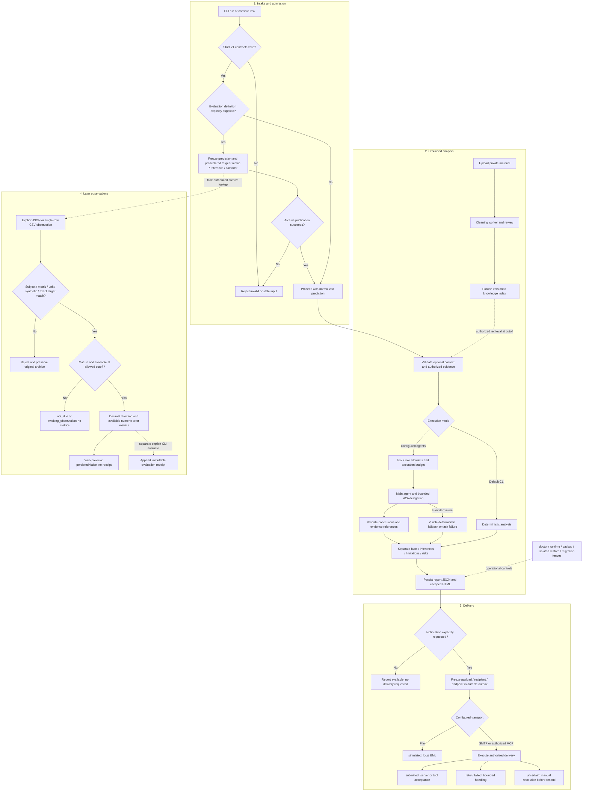

# Runtime flow / 运行流程

[English README](../README.md) · [中文首页](../README.zh-CN.md) · [简体中文说明](#chinese)

## Animated overview

[English animation](assets/runtime-flow.en.svg) · [中文动画](assets/runtime-flow.zh-CN.svg)

The diagrams are self-contained SVG images with declarative motion, no JavaScript, external fonts, trackers, or live-data requests. Animation illustrates routes rather than actual timing or task status. All text and paths remain visible without animation; reduced-motion preferences hide moving markers and stop animated strokes. GitHub readers whose renderer suppresses SVG animation can open the original asset, or use the static Mermaid reference below.

Regenerate both assets with `uv run python scripts/build_runtime_diagram.py`; verify synchronization with `--check`. Keep both language variants aligned with the implementation.

## Detailed static reference

The CLI can enqueue without delivering, and the console can generate a report without notification. The diagram groups those decisions under explicit notification. A configured MCP endpoint can simulate acceptance; the transport's actual receipt remains authoritative. A provider error does not always produce a usable fallback: admission errors, cancellation, invalid archive definitions, and task-wide time/budget limits can terminate the task.

### Boundaries that matter

- **Archive before analysis:** only opt-in tasks register a forecast. The stored prediction and definition bind reports and mail; later failures do not erase a successful registration.
- **Evidence before inference:** context/knowledge remains attributed source material. Role-selected conclusions must reference allowed evidence.
- **Frozen delivery:** changing active SMTP/tool settings does not silently redirect an already-bound message. Retry and uncertain outcomes have different rules.
- **Point-in-time observations:** prediction intake expiry does not define maturity. Observations match the declared target and can only be scored when available at the cutoff.
- **Preview versus receipt:** the browser preview uses one verified record snapshot and has no publication path. Official receipts are an explicit CLI operation.
- **Local privacy:** task-owner authorization does not mean internet multi-tenant security. Some indexes and outputs are plaintext; see [Security](../SECURITY.md).

Implementation anchors: [CLI](../src/stock_predict_mailer/cli.py), [orchestrator](../src/stock_predict_mailer/control/orchestrator.py), [MailCore](../src/stock_predict_mailer/mail_core/service.py), [archive](../src/stock_predict_mailer/agent_service/forecast_archive.py), [preview](../src/stock_predict_mailer/control/forecast_preview.py), [operations](../src/stock_predict_mailer/operations).

## 简体中文说明

动态图是仓库内自包含 SVG，使用声明式动画，不包含脚本、外部字体、跟踪器或实时请求。它解释执行路径，不代表真实任务计时；减少动态效果时隐藏移动标记并停止流动描边，所有文字与连接仍可读。如果 GitHub 或阅读器抑制动画，可打开原 SVG，或查看上方完整 Mermaid 静态流程。

### 四个阶段

1. **接入与准入：** CLI 或控制台接收预测，严格检查字段、有限数值、标的与有效期。本轮明确提供评价定义才先注册；注册失败停止后续调用。
2. **有依据的分析：** 上下文与获准知识证据先校验，再进行确定性或配置后的 Agent 分析；委派、工具、步骤、时间和预算受限制，错误与降级可见。最后保存分层 JSON/HTML 报告。
3. **可靠交付：** 无通知请求时仅保留报告；请求通知后冻结邮件正文、收件人和端点。文件投递为本地模拟，服务器或工具接收不等于最终送达。不确定状态须人工核对，不能当普通重试。
4. **之后核对观测：** 显式提供 JSON/单行 CSV，匹配标的、指标、单位、合成标记和精确目标，再校验截止与可用时间。未到期或不可用不评分；网页始终只预览，正式回执由独立 CLI 命令追加。

CLI 可以只入队不发送，控制台也可以只生成报告。上图将交付选择概括为明确通知；MCP 服务也可能返回模拟结果，应以实际回执为准。不是所有失败都能降级：准入错误、取消、非法定义和任务总体预算/超时可直接结束任务。

### 需保持的边界

事前归档与报告/邮件绑定同次预测；后续失败不删除已经注册的样本。来源材料始终带归属，不把声明变成独立认证。邮件端点变更不能隐式重定向已冻结消息。预测接收有效期不等于目标到期时间。浏览器预览没有落盘路径，不会改正式档案或历史报告。运行诊断、备份恢复和迁移使用独立门禁，不会因为查询或预览自动启动 Worker、采集或重发邮件。

图表生成命令见上方；中英文资产同步维护。权限与加密的实际覆盖范围以[安全策略](../SECURITY.md#chinese)及各专题手册为准。
