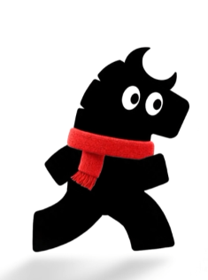
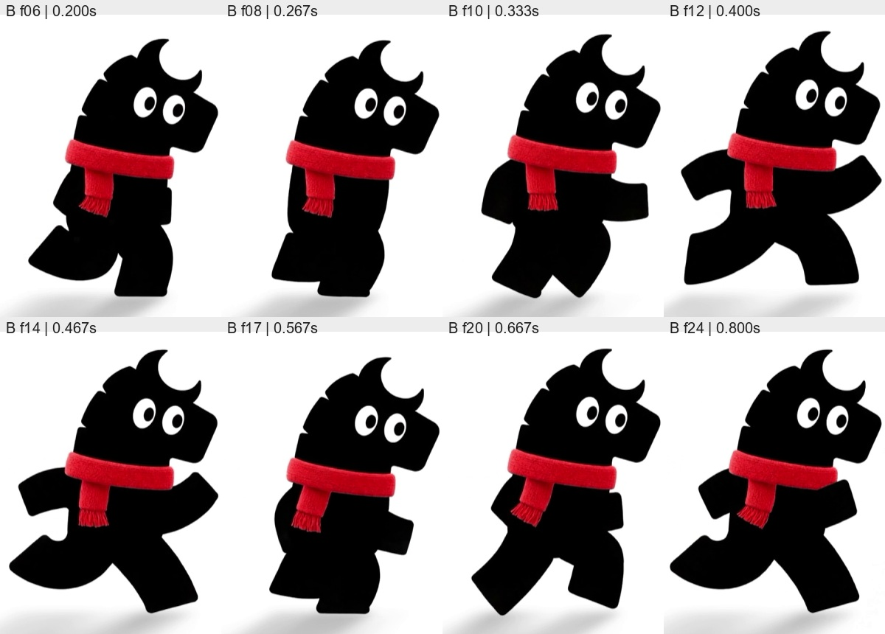
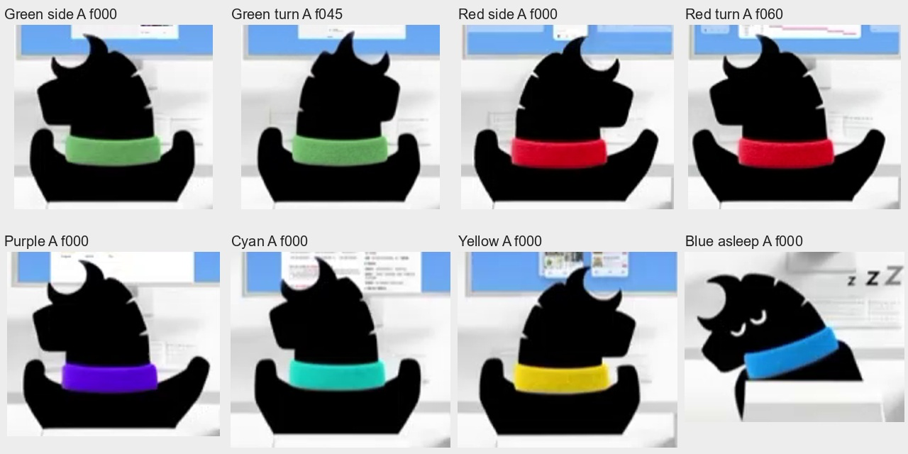
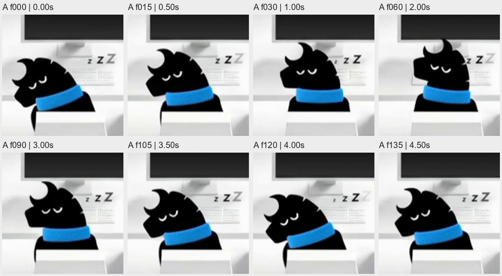

# 参考角色重构设计方案 V1

日期：2026-11-12。状态：用户已确认并实施 V1；[实施与验收记录](../../reference-character-validation.md)。本文件保留原设计基准。

## 1. 目标与素材基准

按用户提供的两段视频和一张图片，重新建立角色造型、动作和表情基准。重构目标是让参考中已经出现的姿态，在相同视角、尺度与动作相位下逐帧对应。角色的轮廓、眼睛、四肢、围巾和动作节奏都以素材为准。

素材分工如下：

- **静态造型母版**：`codex-clipboard-3c1e95ec-5f25-4f8d-9764-6eb038371dab.png`，235×316。用于确定头型、月牙状额毛、头后缘缺口、双眼、块状手臂、大步腿型、围巾厚度和流苏。
- **视频 A／办公室**：`20261111-1550-23.2547591.mp4`，1436×694、30fps、14.9 秒、447 帧。用于确定六种围巾配色、背面坐姿、转头、双臂的小幅动作、打瞌睡和遮挡关系。
- **视频 B／行走**：`20261112-1230-06.5836938.mp4`，854×620、30fps、约 1.833 秒、55 帧。用于确定横向行走的张腿、收腿、摆臂、身体起伏、围巾变化及地面投影。

已把 A 的 447 帧与 B 的 55 帧全部解码，并通过连续帧联系表检查。下文帧号从 0 开始，时间为帧号÷30；抽帧文件的编号从 1 开始。

素材未提供原始模型、骨骼、材质、透明图层或所有方向。因此，“一模一样”落实到**已有画面的可见轮廓、表情、位置关系及运动节奏**；被遮住的身体和未出现的动作需要另行设计，不能描述为已经从参考确认。

## 2. 已确认的角色特征

### 2.1 整体视觉

角色是两足、短躯干、大头、粗短四肢的黑色剪影角色。大白眼和有织物质感的彩色围巾构成主要细节。身体的黑色区域非常统一，肢体与躯干靠外轮廓和遮挡区分。

参考办公室存在空间透视和柔和阴影，但这不能证明角色必须用某一种三维建模方式。重构应先把画面中的剪影、姿态和材质关系做对。

这次造型母版不加入素材中未能确认的独立尖耳、内耳、鼻孔、嘴线、腮红、分色口鼻、指头、鞋子或尾巴。月牙两端的尖部属于需要照着保留的头部轮廓，不能误删，也不能解释成可独立摆动的耳朵。

### 2.2 头部

- 头型前后不对称；后脑较饱满，脸朝向一侧，前端有短而宽的凸出轮廓。
- 头顶的主要识别点是**一块向内挖空的月牙状额毛轮廓**，同时具有外凸尖端与内凹弧。
- 头后缘不是光滑圆弧，有几处短小的阶梯状、鬃毛状缺口；位置和深浅按母版逐点描摹。
- 脸前端与头部保持相同黑色，不画一个独立的灰色口鼻块。
- 下颌、后脑与围巾相互压住，保持短脖子的感觉。
- 头顶和后缘先作为头的一部分，随整头运动。参考中没有足够证据支持额外的随机耳动或鬃毛摇摆。

### 2.3 躯干和四肢

躯干短而紧凑，肩部在围巾下方，腰腹过渡圆润。站立和迈步时，头、躯干与腿读起来应是一块连续黑色形体。

手臂是有宽度的短块状形状，边缘略弯，末端钝圆或近似圆角切面。行走时前臂伸向身体前方，另一侧向后摆；肘部转折通过整条手臂外轮廓表现。不能使用细线段、圆形肘点和独立椭圆蹄部拼出最终可见手臂。

腿部明显粗壮，迈大步时前后分开，形成大面积黑色腿形和清楚的腿间白色负形。收腿时两腿靠拢、交错，轮廓紧凑。脚底较宽，脚与小腿之间不增加分色线。腿的弯曲通过轮廓形变表现，不露出机械关节。

### 2.4 围巾

围巾不是一条纯色平带，应保留三个部分：绕颈的一圈厚织物、前侧垂下的一端、末端细流苏。

- 绕颈部分有弧度和厚度，左右端略圆，下沿随颈部转折。
- 垂端在母版的画面左侧偏中位置，有自身宽度和折叠关系；不能随意换边。
- 织物表面有细小绒感与暗部，红色同时存在亮红和深红。
- 流苏是一组细短、不完全齐整的线束；不画成锯齿块，也不画成几根粗长条。
- 行走时围巾末端会弯曲和改变方向，但幅度有限。围颈部分主要跟随脖颈，不能整条围巾像旗子一样摆动。
- 背面坐姿主要显示绕颈部分，前侧垂端自然被身体挡住；不额外在背部挂出一条。

## 3. 尺寸与定位锚点

以下是对静态参考图的像素近似测量，用于描摹起点。图像有抗锯齿；黑色取 RGB 各通道低于 35、眼白取各通道高于 235，因此边缘会比完整可见区域略小。这些数值不是原作者的模型尺寸。

- 全身黑色剪影约在 **x=37–212、y=54–283**，高约 230px，宽约 176px。排除地面软影和画布留白。
- 头部黑色主体约在 **x=84–212、y=54–157**，含月牙状额毛。对应全身高度约 45%，是大头比例。
- 画面左眼的眼白包围范围约 **x=138–157、y=98–122**，约 **20×25px**。
- 画面右眼的眼白包围范围约 **x=165–182、y=105–128**，约 **18×24px**。
- 两只瞳孔的深色范围分别约 **8×11px**；两者都在各自眼白内偏向画面右侧。
- 两眼中心连线向画面右侧下斜。左眼更大、更高，右眼略小、略低，不能做完全对称的两个椭圆。
- 红色围巾连同垂端和流苏约在 **x=76–173、y=144–214**。绕颈部分的厚度需沿其弧形局部测量，不能把整个红色包围盒当成领圈厚度。

制作时将上述全身高度归一为 100 单位，保持各锚点的相对位置。行走每个相位的全身包围盒会变化，不对每一帧分别拉伸到同样宽高；否则迈步幅度和身体起伏会被抹掉。

## 4. 眼睛与面部表情

### 4.1 行走时的睁眼

视频 B 已检查的可见面部帧中，双眼持续睁开。V1 的参考行走片段保持这一状态，不额外插入眨眼、微笑或随机视线。

眼睛包含：两个独立定位的白色椭圆、两个独立定位的黑色椭圆瞳孔，以及各自的裁剪范围。还原眼白的大小差、倾斜、间距和上下错位，再还原瞳孔的位置。瞳孔不能溢出眼白，也不增加高光点、虹膜或眼眶描边。

脸部的精神状态主要来自双眼和头姿。参考没有可清晰确认的嘴部动画；工作、失败、完成等业务状态不通过临时增加笑嘴、皱嘴来表达。

### 4.2 打瞌睡的闭眼

视频 A 左下蓝围巾角色在整段录制中保持闭眼打瞌睡：眼睛是两条短白色弧线，不是压扁后仍残留瞳孔的眼白。

闭眼状态使用单独的眼睑曲线造型；隐藏眼白和瞳孔，调整两条弧线的长度、曲率、间隔和倾斜，使其随头转动。头低垂和抬起时，眼睑也必须在脸部坐标中一起变化。

### 4.3 转头时的可见性

- 真正的背面姿态以黑色后脑轮廓为准，不透出两只眼睛，也不固定留一只“背面眼”。
- 向侧面转动时，根据参考帧显示或遮挡脸部细节；不是只把整颗头压窄。
- 眼睛、月牙状额毛、脸前端、围巾的相对位置共同参与转向。
- 完整正面睁眼造型没有在这些素材里清晰展示，不能直接把现有对称正脸认定为参考原设。

## 5. 行走动作设计

### 5.1 选取可用片段

视频 B 从角色已经进入步态时开始，左侧身体最初被画面裁切；约 f6／0.200s 至 f32／1.067s 可看到完整身体。约 f33／1.100s 开始从右边出画，f45／1.500s 后角色已完全离开。

因此，行走造型从完整可见的中段建立；开头和末尾的截断形状不作为角色部件。视频没有展示从静止起步或减速停步。

### 5.2 需要对应的动作相位

以下帧是可追溯的姿态锚点，不是把整个动作压缩成八张硬切换图片：

1. **f6／0.200s**：腿仍明显分开，一侧脚接近地面；前后手臂保持短块轮廓，围巾垂端有偏折。
2. **f8／0.267s**：两腿开始收拢、交错，整体横向轮廓变窄，头顶较低。
3. **f10／0.333s**：收拢后重新打开，手臂逐渐换到下一摆动位置。
4. **f12／0.400s**：显著的大步张开姿态，前伸手臂抬起，另一侧后摆，身体整体抬高。
5. **f14／0.467s**：张开后的后续摆动，腿与手臂继续推进，不停在“标准大步”上。
6. **f17／0.567s**：再次进入紧凑的交错姿态，腿间负形缩小，头顶下移。
7. **f20／0.667s**：由收拢转入下一次张开，摆臂和围巾末端继续变化。
8. **f24／0.800s**：另一处清晰张开姿态，用于核对周期重复时的轮廓与重心。

全黑的两条腿会互相遮挡，不能仅凭两张形近的张开图就断言是同一只脚回到原位。先用完整连续帧确定前后层和循环衔接点。

### 5.3 节奏与运动关系

- 显著的“张开—收拢—再张开”约每 0.3 秒出现一次；完整左右交替周期初估约 0.6–0.67 秒。最终以连续帧匹配闭合周期，不能把这个估计当成已知的原始动画参数。
- 行走参考中的头顶上下位移约十余像素，相对于约 350px 的可见角色高度，是小幅、有相位关系的起伏。不是全身一齐缩放。
- 躯干主要保持稳定形体，腿形变化和肩部摆动更明显；头有轻微跟随，不做夸张点头。
- 手臂与腿协调摆动，前后遮挡在交错过程中连续变化。不能只给两个相同小腿加正弦旋转。
- 足底、身体根位置和地面软影一并核对。部分姿态足部与软影存在明显间隔，应按画面还原；不能把整段强行修成始终双脚贴地。
- 地面影子相对柔和，随角色平移；形状和浓淡变化受控，不画成固定深黑椭圆。
- 参考速度播放时先还原原节奏。接入办公室寻路时用行走距离驱动相位，让速度与步幅一致；放慢移动时同步放慢步态。

### 5.4 新增衔接动作的边界

起步、停步、向左走、走向远处和朝镜头走均未被视频 B 完整展示。第一优先是还原已出现的向右行走。

若办公室路径需要其他方向，应沿用同一套黑色块状轮廓，另做方向姿态。向左运动可以用镜像作为制作起点，但围巾垂端、眼睛不对称和转身关系需要单独复核，不能把镜像结果称为已经通过参考验证。

## 6. 办公室坐姿与动作设计

### 6.1 固定视角与遮挡

视频 A 是从角色身后略高处看向显示器。五只活跃角色的主体是后脑、围巾环、上背，以及左右两侧向前抬起的粗短手臂；椅背遮挡下半身。不能把侧面行走角色缩小后直接贴到椅子前。

姿态基准包含：坐姿后脑、向左转头、向右转头、双臂中位、一侧微抬、另一侧微抬。肩、手臂根部与上背连续衔接，呈宽而紧凑的 U 形总体轮廓。

原视频看不到足够细的手指和按键接触细节，能确认的是短臂的小幅上下动作。因此视觉上不增加手指；后续实际键鼠操作仍可以保留接触约束，让末端落在设备范围内。

### 6.2 转头

以原视频中的后脑与两侧轮廓作为关键姿态，分别控制脸前端露出量、后脑宽度、月牙位置和头后缘缺口。围巾环留在颈部，随着颈部视角发生受控变化，不和头部完全刚性地一起旋转。

例如，上排绿色角色在约 1.2–1.6 秒可见一轮明显转头，红色角色在约 1.8–2.3 秒的朝向变化与它不同步。实际制作逐角色记录自己的姿态时间轨，不给六只角色套同一个正弦函数再随便错开。

### 6.3 双臂操作

两侧手臂围绕肩部做短距离抬起、压下和停顿。最终绘制使用完整闭合轮廓，让肩、弯折和手端保持粗短；内部关节计算不直接暴露到画面。

动作包含一侧抬起、另一侧保持、交换，以及中间的短暂停顿。后脑的转动和手臂动作允许不同相位。身体不随每次输入大幅摇摆。

### 6.4 打瞌睡

左下蓝围巾角色是独立的睡眠循环，主要包括：

1. 头部向画面左侧、向下垂，围巾随颈部斜置；双臂不继续作活跃输入。
2. 头部缓慢回抬，眼睛始终保持两条闭眼弧线。
3. 在较直立的闭眼姿态短暂经过或停留。
4. 再次缓慢垂下，循环重复。

整个头姿循环从画面估计约 5–6 秒，不能套用快速点头。右上方有 `z Z Z` 睡眠提示，显示器保持黑屏。图中的字母是状态图形，不是眼睛或角色身体的一部分。

参考没有醒来动作。办公室收到真实任务后需要唤醒，建议作为新增衔接：头回到工作姿态、闭眼弧线切换到睁眼造型、双臂恢复输入；具体时长在实现阶段单独校准。不能将该唤醒过程写成参考中已经出现。

## 7. 材质、色彩与角色身份

身体以接近纯黑的统一面为主。不要为了表现体积，把脸、手、腿分别涂成明显不同的灰色；不添加额外轮廓描边。围巾的织物细节承担主要材质表现，地面软影帮助角色落在空间里。

视频 A 的六个位置配色已确认：上排为绿、红、紫；下排为蓝、黄、青。六只角色使用同一个造型母版，以围巾区分。不同头型、耳形和毛色不是本轮参考要求。

在视频 A 第 0 帧，对围颈区域做局部饱和像素中位数采样，可得到下列显示色参考：绿约 `#66A460`、红约 `#C4001E`、紫约 `#5200CF`、蓝约 `#1485CF`、黄约 `#D4BB10`、青约 `#16C1B0`。这些是录屏压缩、光照和纹理共同作用后的区域近似值，不能用一个采样值替代整条围巾的明暗。

静态图的红围巾更明亮，制作时保留它的亮部与织物纹理；办公室视角再按视频 A 核对显示结果。没有原始色彩管理数据，不能宣称这些采样就是原始材质色。

现有系统中，主 Agent／预测／风险／邮件／图表／建议的职责与红／绿／紫／蓝／青／黄可以继续对应。第七只橙色助理是现有系统的扩展，参考视频没有这只角色：如需保留，使用相同黑色母版和橙围巾，不给它另造头型或身体比例。

## 8. 推荐的制作方式

### 方案 A：轮廓描摹＋关键姿态形变＋围巾纹理，推荐

按静态图逐部件建立闭合轮廓，再从视频建立行走、坐姿、转头和睡眠的关键姿态。使用受控的路径形变和隐藏关节驱动，使每一关键姿态都能与原帧叠加比较。身体保持统一黑色；围巾加入局部细纹理与明暗。

优点是能精确控制参考中最重要的黑色边界，能接入现有 SVG 场景，也能继续使用键鼠和门把手的接触约束。制作成本集中在轮廓与姿态，不需要先猜测看不到的立体结构。

### 方案 B：透明逐帧素材／序列帧

对已有视角可以最直接地保留轮廓、织物和节奏，适合作为参考回放和视觉比对基线。作为完整办公室运行素材时，缺少未展示方向、操作门和坐下起身等动作；从白底和已有软影中提取透明边缘也需要处理。单独采用此方案难以覆盖现有交互。

### 方案 C：完整三维角色与骨骼

便于自由转向和设备接触，但需要推断原始体积、相机、光照和拓扑。同样的模型在不同角度下容易与参考剪影产生偏差。对于本次强调已有画面一致性的目标，不建议把完整三维重建作为第一步。

**V1 采用方案 A，以原始逐帧画面作为比对基线。** 是否未来转三维，应等造型和已出现动作通过视觉验收后再决定。

## 9. 角色资产与动作结构

角色资产分为头部外轮廓、眼白、瞳孔、闭眼弧线、躯干、远侧手臂、近侧手臂、远侧腿、近侧腿、围巾环、围巾垂端、流苏和独立地面影子。

这些是制作层，不要求观众看到接缝。肩、髋、颈处保留重叠量，转动时不能出现白缝。手臂与腿的前后绘制顺序随方向和相位变化。

动作数据分开管理：

- **参考动作轨**：保存对应视频、帧号、时间、头姿、四肢轮廓、眼睛状态和围巾状态，可按时间精确回放。
- **场景移动轨**：保存实际位置、速度、朝向和路径，以行进距离推进步态，不让身体和脚各自漂移。
- **接触轨**：负责键盘、鼠标和门把手的世界坐标。需要触碰时，由接触约束驱动隐藏关节，再生成完整手臂轮廓。
- **业务状态轨**：继续消费真实任务开始、等待、完成、失败、取消等事件，决定使用何种姿态；不把随机表情当成任务事实。

在有参考的动作回放中关闭额外随机眨眼、耳动、尾动、嘴型和呼吸叠加，保证可以按同一时间码比较。需要日常待机细节时，另列为扩展动作，不混入参考还原片段。

## 10. 与现有项目的改动对应

本节是后续实施边界，本轮不修改以下代码。

- `src/stock_predict_mailer/control/web/modules/pony-rig.js`：重做头部轮廓、眼睛定位、闭眼造型、连续块状肢体和围巾。保留关节与接触求解的职责，但最终手臂由闭合形状绘制。
- `src/stock_predict_mailer/control/web/modules/pony-office.js`：重做参考动作采样、方向造型、层级遮挡和地面影子；坐姿不再依靠显示一只固定背面眼，睡眠不再靠把眼睛纵向压扁。
- `src/stock_predict_mailer/control/web/modules/pony-model.js`：按新角色尺寸校准速度、步幅、坐姿锚点和碰撞体，继续沿用任务联动和寻路职责。围巾配色与实际角色身份保持对应。
- `pony-door.js` 及已有设备锚点：按新身体比例核对可达范围；空间不够时调整角色站位或接近路径，不通过拉长手臂获得接触。
- `tests/test_pony_rig.cjs`：现有“走路脚端横向小于 15”“放松手端必须收在躯干内”等约束，会限制参考中的大步和摆臂，需要改为参考姿态包络。固定长度、触碰连续、目标可达与不穿地等有效约束保留。
- `scripts/build_console.py`：实现完成后统一生成 `memory.js`，不直接修改生成文件。

角色比例变化可能影响椅背遮挡、桌面高度、门洞裁剪和角色间距，应随角色一起核对。这次方案不要求重排整个办公室或修改后端协议。

## 11. 原素材没有覆盖的内容

以下属于办公室运行所需的新增衔接，不能以“一比一复刻原视频”验收：

- 从静止起步、减速停步和完整转身。
- 完整正面睁眼、背向行走、其他方向的足部轨迹。
- 走到椅子、坐下、起身和下半身的完整坐姿。
- 开门、关门、握住把手和门口等待。
- 打瞌睡到清醒，以及任务被打断后的恢复。
- 失败、取消、成功等业务状态对应的新增身体反馈。

这些动作全部沿用同一母版、块状肢体、无额外嘴型的视觉规则。业务状态首先通过屏幕、文字和已有任务指示表达，不通过改变角色长相表达。

## 12. 制作和验收顺序

### 第一阶段：静态母版

交付与参考图同姿态的角色，核对月牙内凹弧、后脑缺口、脸前端、两眼、手臂、腿间负形、围巾和流苏。先在参考白底、原比例上检查，再放入办公室。

采用并排图、50% 透明叠加和轮廓差异图共同检查。不可单独缩放头或四肢来对齐；先统一全身尺度，再检查局部偏差。

### 第二阶段：向右行走

交付带帧号的关键姿态与连续循环。以视频 B 完整可见片段逐帧比较，检查张开、交错、手臂换位、围巾末端、头顶起伏和软影。不因为单张大步图接近就判定整个动作通过。

同速并排播放、慢速播放和逐帧检查都要通过。循环接缝不能出现眼睛、腿形、围巾或根位置跳变。

### 第三阶段：坐姿、转头、睡眠

交付与视频 A 六个位置相对应的回放轨。检查背面不露眼、手臂粗短、椅背遮挡和各角色不同步。蓝围巾角色保持闭眼弧线、慢速垂头和黑屏，不混入睁眼或活跃敲键盘。

### 第四阶段：办公室衔接

在前三阶段的外观和原动作通过后，补齐起停、方向、落座、起身、开关门和任务唤醒。核对键鼠接触、门把手接触、门洞裁剪、脚底、椅子和角色碰撞。新动作与原动作分别记录验收证据。

### 验收尺度

以下是建议的 V1 验收门槛，属于制作目标，尚不是已达到的结果：

- 在约 230px 高的静态参考尺度上，眼睛中心、瞳孔、月牙尖端和围巾边缘等关键锚点，优先控制在约 1–2px 的偏差内。
- 头部和身体的黑色轮廓重叠率可以辅助检查，但不能用一个高重叠率掩盖眼睛、月牙或腿间负形明显错误。
- 相同参考相位的时间差优先控制在一个 30fps 视频帧内，约 33ms；录屏重复帧按来源保留并注明，不凭空提高动作采样精度。
- 静态图、向右行走、背面坐姿、转头、睡眠五项分别验收，任何一项不通过都不能被导航或业务测试通过替代。
- 场景接触、门口通行、任务联动和减少动态效果模式继续做回归，但它们只能证明运行正确，不能证明造型相似。

## 13. V1 交付清单

本轮已交付：这份设计方案、静态参考副本、行走关键帧板、办公室姿态板、睡眠关键帧板。图片板均从原始素材复制或抽帧组合，没有重新生成角色。

后续实现应交付：带锚点的造型母版、行走关键姿态与循环、背面坐姿与转头姿态、独立闭眼睡眠造型、六色围巾资产、必要衔接动作、可按时间码定位的比对页面、同尺度叠加图及独立视觉验收记录。

本地完整检查材料保存在 `.tmp/character-reference-review/`：A 的 447 张源帧、B 的 55 张源帧、A 的 15 张全帧联系表、B 的 3 张全帧联系表，以及基础运动包围盒测量记录。该目录是分析工作材料，不是角色运行资源。

方案的核心制作约束是：**以参考轮廓建立母版，以参考连续帧建立动作，以单独的闭眼曲线建立睡眠表情；先让已经看得到的内容对应，再设计看不到的衔接。**
